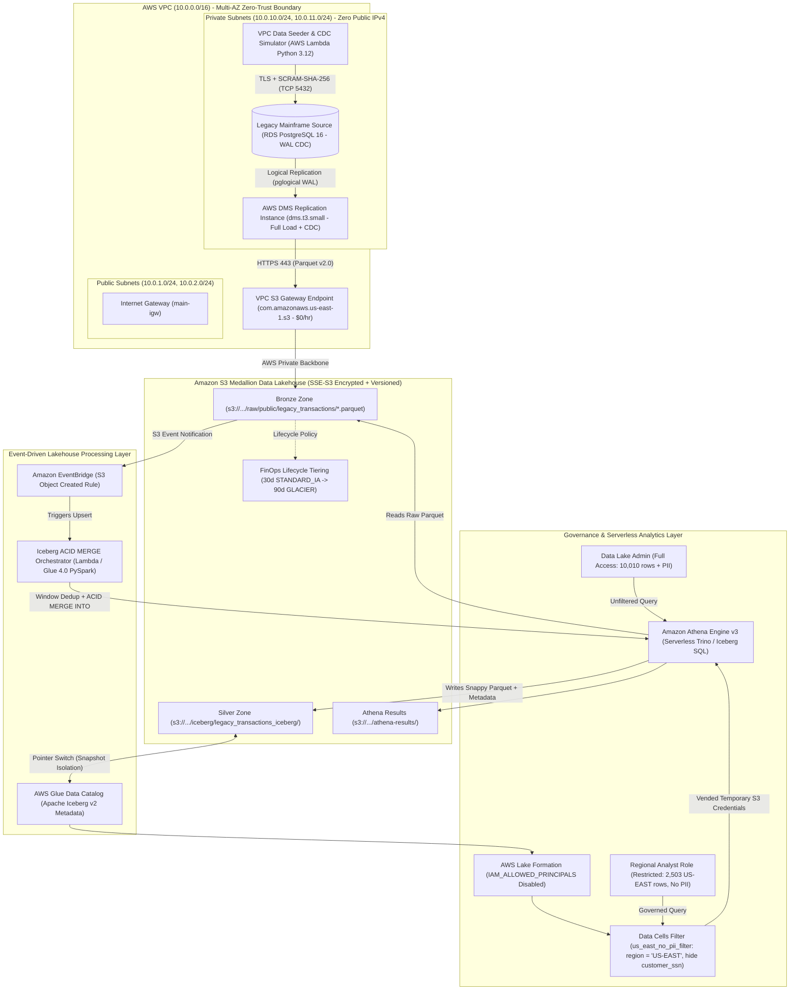
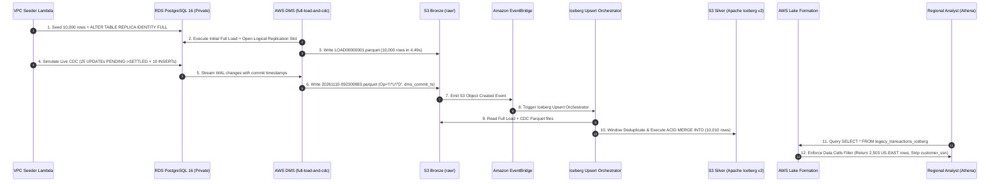

# System Architecture: AWS Mainframe-to-Lakehouse Modernization

This document details the end-to-end technical architecture, network topology, data model, Change Data Capture (CDC) mechanics, Apache Iceberg ACID upsert pipeline, AWS Lake Formation governance model, and FinOps engineering decisions for the **AWS Mainframe Modernization Lakehouse**.

---

## 1. End-to-End Architectural Schematic

### 1.1 Interactive Mermaid Architecture Diagram (GitHub Rendered)



---

### 1.2 ASCII Architecture Blueprint (Terminal & Raw View)

```text
+===================================================================================================+
|                                    AWS CLOUD (us-east-1)                                          |
|                                                                                                   |
|  +---------------------------------------------------------------------------------------------+  |
|  | VPC: 10.0.0.0/16 (Multi-AZ, DNS Enabled, Zero NAT Gateway Cost)                             |  |
|  |                                                                                             |  |
|  |  +---------------------------------------------------------------------------------------+  |  |
|  |  | PRIVATE SUBNETS: 10.0.10.0/24 (AZ-a) & 10.0.11.0/24 (AZ-b) [publicly_accessible=false]|  |  |
|  |  |                                                                                       |  |  |
|  |  |  +------------------------+    TCP 5432     +--------------------------------------+  |  |  |
|  |  |  | VPC Seeder Lambda      | --------------> | RDS PostgreSQL 16 (mainframe_core)   |  |  |  |
|  |  |  | (10k Rows + CDC Delta) |  (TLS/SCRAM)    | rds.logical_replication = 1          |  |  |  |
|  |  |  +------------------------+                 | REPLICA IDENTITY FULL                |  |  |  |
|  |  |                                             +------------------+-------------------+  |  |  |
|  |  |                                                                |                      |  |  |
|  |  |                                                     WAL Stream | (TCP 5432)           |  |  |
|  |  |                                                                v                      |  |  |
|  |  |                                             +--------------------------------------+  |  |  |
|  |  |                                             | AWS DMS (dms.t3.small)               |  |  |  |
|  |  |                                             | Task: full-load-and-cdc (Parquet v2) |  |  |  |
|  |  |                                             +------------------+-------------------+  |  |  |
|  |  +----------------------------------------------------------------|----------------------+  |  |
|  |                                                                   | HTTPS 443               |  |
|  |                                                                   v                         |  |
|  |                                        +-------------------------------------------------+  |  |
|  |                                        | VPC S3 Gateway Endpoint (com.amazonaws...s3)    |  |  |
|  |                                        +--------------------------+----------------------+  |  |
|  +-------------------------------------------------------------------|-------------------------+  |
|                                                                      | AWS Backbone ($0/GB)       |
|                                                                      v                            |
|  +---------------------------------------------------------------------------------------------+  |
|  | AMAZON S3 MEDALLION DATA LAKEHOUSE (AES-256 SSE-S3, Bucket Key, Versioned)                  |  |
|  |                                                                                             |  |
|  |  [ BRONZE: s3://.../raw/ ]                     [ SILVER: s3://.../iceberg/ ]                |  |
|  |  - LOAD00000001.parquet (10,000 rows)          - Apache Iceberg v2 Format (Snappy Parquet)  |  |
|  |  - 20261110-*.parquet   (CDC I/U/D deltas)     - Partitioned by `region`                    |  |
|  |  - Lifecycle: 30d IA -> 90d Glacier            - ACID Snapshot Isolation & Time Travel      |  |
|  +--------------------+---------------------------------------------------+--------------------+  |
|                       |                                                   ^                       |
|    S3 Object Created  |                                                   | ACID MERGE INTO       |
|                       v                                                   | (Dedup by commit_ts)  |
|  +----------------------------------------+          +--------------------+--------------------+  |
|  | Amazon EventBridge                     | -------> | Iceberg Upsert Orchestrator             |  |
|  | Rule: prefix = raw/public/legacy_tx/   |          | (Athena Engine v3 / Glue 4.0 PySpark)   |  |
|  +----------------------------------------+          +-----------------------------------------+  |
|                                                                           |                       |
|                                                                           v                       |
|  +---------------------------------------------------------------------------------------------+  |
|  | GOVERNANCE & ANALYTICS: AWS Glue Data Catalog + AWS Lake Formation + Amazon Athena v3       |  |
|  |                                                                                             |  |
|  |  * IAM_ALLOWED_PRINCIPALS ("Super") Revoked                                                 |  |
|  |  * Data Cells Filter (`us_east_no_pii_filter`):                                             |  |
|  |      - Row Filter:    region = 'US-EAST'  (2,503 of 10,010 rows visible)                    |  |
|  |      - Column Filter: Excludes `customer_ssn` PII column                                    |  |
|  +---------------------------------------------------------------------------------------------+  |
+===================================================================================================+
```

---

## 2. End-to-End CDC & ACID Upsert Sequence



---

## 3. Infrastructure & Module Breakdown

| Terraform File | Architectural Layer | Key AWS Resources Provisioned |
| :--- | :--- | :--- |
| [providers.tf](file:///c:/Users/gmnya/Documents/Projects/aws-mainframe-modernization-lakehouse/providers.tf) & [versions.tf](file:///c:/Users/gmnya/Documents/Projects/aws-mainframe-modernization-lakehouse/versions.tf) | **State Management** | S3 Remote State Backend with **Native S3 State Locking (`use_lockfile = true`)**, eliminating external DynamoDB state-lock tables. |
| [networking.tf](file:///c:/Users/gmnya/Documents/Projects/aws-mainframe-modernization-lakehouse/networking.tf) | **Zero-Trust Network** | Multi-AZ VPC (`10.0.0.0/16`), 2 Public Subnets (`10.0.1.0/24`, `10.0.2.0/24`), 2 Private Subnets (`10.0.10.0/24`, `10.0.11.0/24`), Internet Gateway, Route Tables, and **S3 Gateway VPC Endpoint**. |
| [storage.tf](file:///c:/Users/gmnya/Documents/Projects/aws-mainframe-modernization-lakehouse/storage.tf) | **Medallion Storage** | S3 Data Lakehouse bucket (`AES256` encryption, Bucket Keys, Versioning, Public Access Block, and 30d `STANDARD_IA` / 90d `GLACIER` raw archival lifecycle rules). |
| [iam.tf](file:///c:/Users/gmnya/Documents/Projects/aws-mainframe-modernization-lakehouse/iam.tf) | **Identity & Access** | Least-privilege IAM Role for DMS (write-only to `s3://.../raw/*`) and IAM Role for Glue ETL (read `raw/*` & `scripts/*`, read/write `iceberg*` & `temp/*`). |
| [database.tf](file:///c:/Users/gmnya/Documents/Projects/aws-mainframe-modernization-lakehouse/database.tf) | **Legacy Source** | Private Multi-AZ Subnet Group, VPC-isolated Security Group (TCP `5432`), Parameter Group (`rds.logical_replication = 1`, `wal_sender_timeout = 0`), and RDS PostgreSQL 16 (`db.t3.micro`, `gp3` encrypted). |
| [seeder.tf](file:///c:/Users/gmnya/Documents/Projects/aws-mainframe-modernization-lakehouse/seeder.tf) | **Data Generation** | Private-subnet AWS Lambda ([scripts/seed_mainframe_data.py](file:///c:/Users/gmnya/Documents/Projects/aws-mainframe-modernization-lakehouse/scripts/seed_mainframe_data.py)) with a zero-dependency TLS + `SCRAM-SHA-256` PostgreSQL v3 wire-protocol client. |
| [dms.tf](file:///c:/Users/gmnya/Documents/Projects/aws-mainframe-modernization-lakehouse/dms.tf) | **CDC Ingestion** | DMS Service Roles (`dms-vpc-role`, `dms-cloudwatch-logs-role`), Private DMS Instance (`dms.t3.small`), PostgreSQL Source Endpoint (`ssl_mode = "require"`), S3 Parquet v2.0 Target Endpoint, and `full-load-and-cdc` Replication Task. |
| [lakehouse.tf](file:///c:/Users/gmnya/Documents/Projects/aws-mainframe-modernization-lakehouse/lakehouse.tf) | **Lakehouse Compute** | Glue Catalog Database (`mainframe_modernization_lakehouse_dev`), Athena Workgroup, Glue 4.0 PySpark Job ([scripts/glue_iceberg_upsert.py](file:///c:/Users/gmnya/Documents/Projects/aws-mainframe-modernization-lakehouse/scripts/glue_iceberg_upsert.py)), and Serverless Athena Iceberg Orchestrator ([scripts/iceberg_upsert_orchestrator.py](file:///c:/Users/gmnya/Documents/Projects/aws-mainframe-modernization-lakehouse/scripts/iceberg_upsert_orchestrator.py)). |
| [automation.tf](file:///c:/Users/gmnya/Documents/Projects/aws-mainframe-modernization-lakehouse/automation.tf) | **Event Automation** | S3 EventBridge Notification + EventBridge Rule matching `Object Created` under `raw/public/legacy_transactions/` to trigger automatic Iceberg `MERGE INTO` upserts. |
| [governance.tf](file:///c:/Users/gmnya/Documents/Projects/aws-mainframe-modernization-lakehouse/governance.tf) | **Lakehouse Security** | Lake Formation Data Lake Settings (`IAM_ALLOWED_PRINCIPALS` disabled), S3 Resource Registration, Regional Analyst IAM Role, and Data Cells Filter (`us_east_no_pii_filter`). |

---

## 4. Data Model & CDC Deduplication Logic

### 4.1 Schema Evolution Across Medallion Zones

| Column Name | Source RDS (`PostgreSQL 16`) | Bronze S3 Raw (`DMS Parquet v2.0`) | Silver Lakehouse (`Apache Iceberg v2`) | Lake Formation Analyst View (`us_east_no_pii_filter`) |
| :--- | :--- | :--- | :--- | :--- |
| `transaction_id` | `VARCHAR(24) PK` | `STRING` | `STRING` (Merge Key) | Visible |
| `account_number` | `VARCHAR(20)` | `STRING` | `STRING` | Visible |
| `customer_name` | `VARCHAR(100)` | `STRING` | `STRING` | Visible |
| `customer_ssn` | `VARCHAR(11)` (PII) | `STRING` | `STRING` | **Excluded (PII Masked)** |
| `transaction_type` | `VARCHAR(20)` | `STRING` | `STRING` | Visible |
| `amount` | `NUMERIC(12,2)` | `DECIMAL(12,2)` | `DECIMAL(12,2)` | Visible |
| `currency` | `CHAR(3)` | `STRING` | `STRING` | Visible |
| `branch_code` | `VARCHAR(12)` | `STRING` | `STRING` | Visible |
| `region` | `VARCHAR(20)` | `STRING` | `STRING` (**Partition Key**) | **Filtered to `'US-EAST'` Only** |
| `status` | `VARCHAR(20)` | `STRING` | `STRING` | Visible |
| `cobol_batch_id` | `VARCHAR(24)` | `STRING` | `STRING` | Visible |
| `created_at` | `TIMESTAMP` | `TIMESTAMP` | `TIMESTAMP(6)` | Visible |
| `updated_at` | `TIMESTAMP` | `TIMESTAMP` | `TIMESTAMP(6)` | Visible |
| `dms_commit_ts` | *(N/A - WAL Metadata)* | `STRING` (UTF-8 Binary) | `TIMESTAMP(6)` | Visible |
| `Op` | *(N/A - WAL Metadata)* | `STRING` (`'I'`, `'U'`, `'D'`) | *(Consumed by `MERGE INTO`)* | *(N/A)* |

### 4.2 Window-Based CDC Deduplication (`MERGE INTO` Cardinality Protection)
When AWS DMS writes both an initial Full Load (`LOAD00000001.parquet`) and subsequent CDC delta files (`20261110-*.parquet`), the same `transaction_id` can appear multiple times across files (e.g., `status = 'PENDING'` in the initial load and `status = 'SETTLED'` in a CDC file).

To prevent Apache Iceberg `MERGE INTO` cardinality violations and guarantee that only the latest transaction state is applied:
1. `dms_commit_ts` (serialized by DMS as a UTF-8 `STRING`) is parsed via `COALESCE(TRY(CAST(dms_commit_ts AS TIMESTAMP(6))), CAST(updated_at AS TIMESTAMP(6)))`.
2. A window function partitions by `transaction_id` and orders by `dms_commit_ts DESC, updated_at DESC`, selecting `_rn = 1`.
3. The deduplicated dataset is merged atomically:
   * `WHEN MATCHED AND source.Op = 'D' THEN DELETE`
   * `WHEN MATCHED AND source.Op <> 'D' THEN UPDATE SET ...`
   * `WHEN NOT MATCHED AND source.Op <> 'D' THEN INSERT ...`

---

## 5. Security-as-Code & Governance Deep Dive

### 5.1 Zero-Trust Network Isolation
* **No Public Database or Replication Exposure:** Both RDS PostgreSQL 16 and AWS DMS are deployed into `10.0.10.0/24` and `10.0.11.0/24` (`aws_subnet.private`) with `publicly_accessible = false`.
* **Internal-Only Security Groups:**
  * `aws_security_group.rds_mainframe` restricts inbound TCP `5432` strictly to `10.0.0.0/16`.
  * `aws_security_group.dms` and `aws_security_group.rds_seeder` permit outbound TCP `5432` only within `10.0.0.0/16`.
* **Backbone S3 Routing:** All S3 traffic from DMS and private subnets routes through `aws_vpc_endpoint.s3` (`com.amazonaws.us-east-1.s3`), never traversing the public internet.

### 5.2 AWS Lake Formation Fine-Grained Access Control
1. **Eliminating the `IAM_ALLOWED_PRINCIPALS` Bypass:**
   By default, AWS Glue and Lake Formation grant `ALL` (`Super`) permissions to `IAM_ALLOWED_PRINCIPALS`, which allows any role with IAM `glue:GetTable` permissions to bypass Lake Formation filters. This architecture explicitly disables `create_database_default_permissions` and `create_table_default_permissions` in [governance.tf](file:///c:/Users/gmnya/Documents/Projects/aws-mainframe-modernization-lakehouse/governance.tf#L15-L24) and revokes `IAM_ALLOWED_PRINCIPALS` on the Iceberg table.
2. **Credential Vending (`use_service_linked_role = true`):**
   The `us-east-analyst` IAM role has **zero** `s3:GetObject` permissions on `s3://.../iceberg/*`. Instead, when the analyst queries Athena, Athena requests temporary scoped credentials from Lake Formation (`lakeformation:GetDataAccess`), which evaluates `us_east_no_pii_filter` and returns only `region = 'US-EAST'` rows with `customer_ssn` stripped.

---

## 6. FinOps Engineering & Cost Optimization

| Architectural Decision | Traditional Cloud Cost | This Architecture's Cost | Annualized Savings / Impact |
| :--- | :--- | :--- | :--- |
| **VPC S3 Gateway Endpoint vs. Multi-AZ NAT Gateway** | `$0.090/hr` (`2 × $0.045/hr`) + `$0.045/GB` processed | **`$0.00/hr` + `$0.00/GB`** | Saves **`~$788/year`** in fixed NAT Gateway fees |
| **Private Subnets (`publicly_accessible = false`)** | `$0.005/hr` per Public IPv4 address (RDS + DMS) | **`$0.00/hr`** | Saves **`~$87/year`** in AWS Public IPv4 charges |
| **Native S3 State Locking (`use_lockfile = true`)** | DynamoDB Lock Table provisioning & management | **`$0.00`** | Eliminates external state-locking infrastructure |
| **Serverless VPC Seeder (Lambda) vs. EC2 Bastion Host** | `$0.0104/hr` (`t3.micro` 24/7) | **`$0.00`** (AWS Lambda Permanent Free Tier) | Zero idle compute cost & zero SSH key attack surface |
| **S3 Raw Zone Lifecycle Tiering** | `$0.023/GB-month` (`S3 Standard` indefinitely) | `30d STANDARD_IA` (`$0.0125/GB`) -> `90d GLACIER` (`$0.004/GB`) | **Up to 82% storage cost reduction** on historical CDC logs |

---

## 7. Empirical Verification Benchmarks (Live AWS Run)

| Pipeline Stage | Metric Verified | Result |
| :--- | :--- | :--- |
| **Day 5 — VPC Data Seeding** | `10,000` mainframe records inserted over TLS + `SCRAM-SHA-256` | **`0.96 seconds`** (`2,500` rows per region) |
| **Day 9 — DMS Initial Full Load** | `10,000` rows migrated from RDS PostgreSQL 16 to S3 Parquet (`LOAD00000001.parquet`, `1.9 MiB`) | **`4.49 seconds`** (`FullLoadProgressPercent: 100`) |
| **Day 10 — DMS Real-Time WAL CDC** | `25` `PENDING -> SETTLED` updates + `10` new inserts streamed to `20261110-092300883.parquet` (`10.5 KiB`) | **`< 15 seconds`** end-to-end replication latency |
| **Day 12 — Apache Iceberg ACID `MERGE INTO`** | Window deduplication + ACID upsert of `10,035` raw records into `10,010` unique Iceberg v2 rows (`6,068` `SETTLED`) | **`12.52 seconds`** |
| **Day 15 — Lake Formation RLS & PII Masking** | Cross-role Athena query (`us-east-analyst` vs. `Admin`) | Admin sees **`10,010` rows (4 regions + SSN)**; Analyst sees **`2,503` rows (`US-EAST` only, SSN hidden)** |
